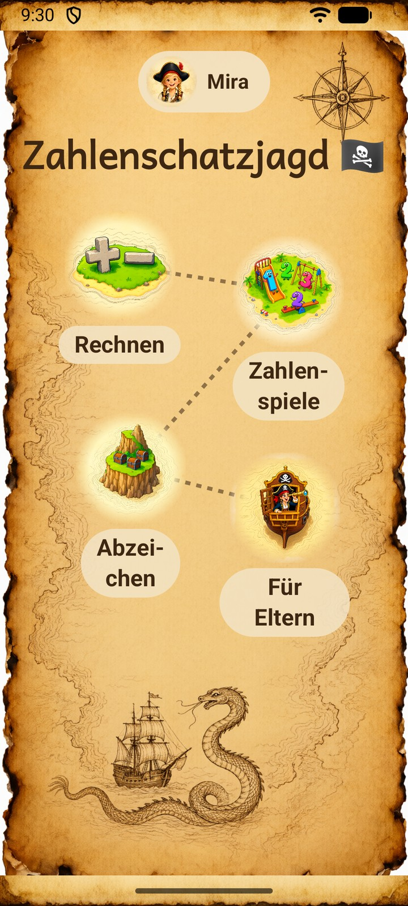
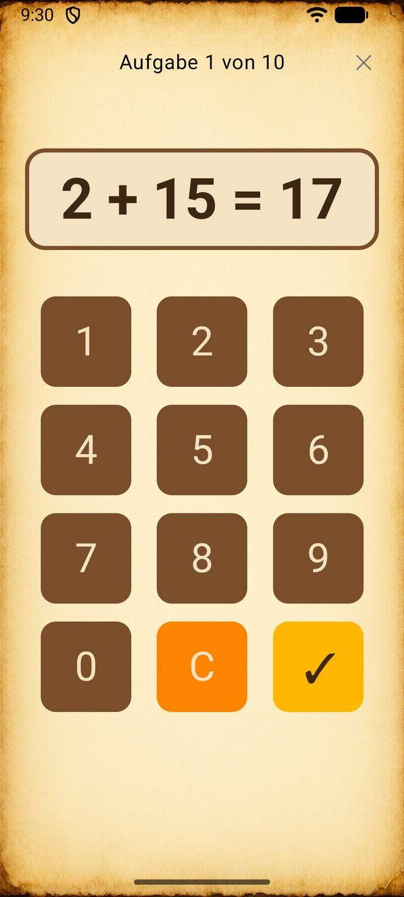
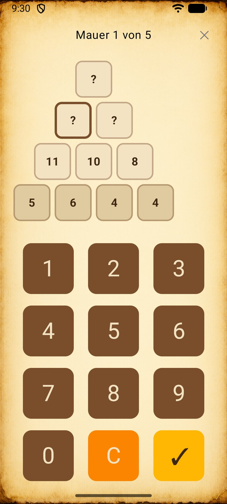
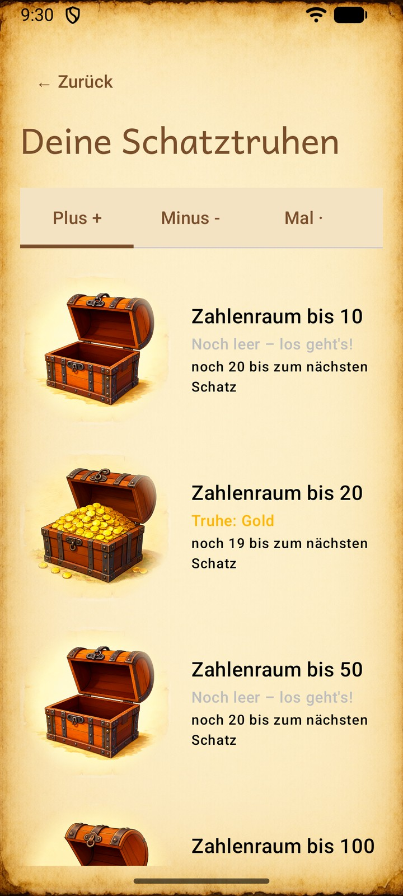
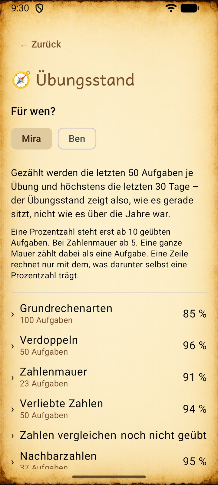

# Zahlenschatzjagd

*Zahlenschatzjagd ("number treasure hunt") is a free Android app that lets children in their
first two school years practise maths on their own – offline, without ads and without a single
permission. It is made for children who cannot read yet: pictures and a voice that reads
everything aloud show the way. Everything here is in German because the app follows the
curriculum of North Rhine-Westphalia and speaks to German-speaking children and parents. Get it
on [F-Droid](https://f-droid.org/packages/io.github.glaside.zahlenschatzjagd/) or from the
[releases](https://github.com/GlasiDe/zahlenschatzjagd/releases/latest).*

## Was die App ist

Eine Lern-App für die **Klassen 1 und 2**, mit der Kinder allein Mathe üben: Grundrechenarten im
Zahlenraum bis 100, dazu Übungsformen, wie sie im Grundschulheft stehen. Die Aufgaben folgen dem
[Lehrplan Mathematik für die Primarstufe in NRW](https://lehrplannavigator.nrw.de/system/files/media/document/file/ps_lp_m_einzeldatei_2025_03_18.pdf);
die Regeln dahinter stehen in [`LEHRPLAN.md`](LEHRPLAN.md).

Die App öffnet auf einer **Schatzkarte**. Das Maskottchen Ella begrüßt das Kind und liest vor, was
es antippt. Jede Insel führt in einen Bereich:

- **Rechnen**
  - **Grundrechenarten** – Plus, Minus, Mal, Geteilt einzeln oder gemischt, Zahlenraum 10, 20,
    50 oder 100, 5 bis 25 Aufgaben je Runde.
  - **Verdoppeln** – leicht mit drei Antworten zur Auswahl, schwer mit dem Ziffernblock.
  - **Zahlenmauer** – jede Zelle ist die Summe der beiden darunter, in vier Stufen; in der
    höchsten wird rückwärts gerechnet.
  - **Einmaleins** – einzelne Reihen von der 2er- bis zur 10er-Reihe, der Reihe nach aufsagen
    oder durcheinander.
- **Zahlenspiele**
  - **Verliebte Zahlen** – Zerlegung der 10, mit oder ohne Münzen als Hilfe.
  - **Zahlen vergleichen** – `<`, `=` oder `>`.
  - **Nachbarzahlen** – zu einer Zahl die Zahl davor und danach finden.
- **Abzeichen** – je Übung (und je Zahlenraum oder Stufe) eine Schatztruhe,
  die sich mit dem Üben füllt, von Bronze bis Platin.
  Am Ende jeder Runde gibt es dazu null bis drei Sterne.
- **Für Eltern** – hinter einer kleinen Rechenaufgabe oder einer PIN:
  - **Übungsstand**: was ein Kind zuletzt geübt hat und wie sicher es sitzt.
  - **Übungskalender**: wann und wie lange geübt wurde.
  - **Freigabe**: was ein Kind üben darf, je Übung und Zahlenraum.
  - **Ton & Vorlesen** abschalten, **Zugang** mit PIN sichern.
  - **Sicherung**: den gesamten Fortschritt als Datei speichern und wieder einspielen.

Mehrere Geschwister teilen sich ein Gerät: Jedes Kind hat ein **Profil** mit eigenem
Piraten-Avatar und eigenem Fortschritt.

Bringt ein Update etwas Neues – etwa eine neue Übung, die für alle Kinder sofort offen ist –,
blendet die App danach einmal einen kurzen **Änderungshinweis** ein, und Ella bittet das Kind,
ihn den Eltern zu zeigen.

## Screenshots

<p>
  
  
  
  
  
</p>

## Installation

Die App läuft ab Android 8.0 und kommt auf zwei Wegen aufs Gerät. Beide liefern **dieselbe,
vom Entwickler signierte APK**: Man kann jederzeit von einem Weg zum anderen wechseln, der
Fortschritt bleibt erhalten ([ADR-0033](docs/adr/0033-f-droid-mit-signatur-des-entwicklers.md)).

**Über F-Droid** (empfohlen, mit automatischen Updates):

<a href="https://f-droid.org/packages/io.github.glaside.zahlenschatzjagd/"></a>

1. Die App [F-Droid](https://f-droid.org/) installieren, falls sie noch nicht auf dem Gerät ist.
2. Darin nach **Zahlenschatzjagd** suchen und installieren. Updates bietet F-Droid von selbst an.

Neue Fassungen erscheinen dort einige Tage nach dem Release auf GitHub, weil F-Droid jede Fassung
erst selbst nachbaut und prüft.

**Direkt von GitHub:**

1. Unter [Releases](https://github.com/GlasiDe/zahlenschatzjagd/releases/latest) die Datei
   `Zahlenschatzjagd-….apk` auf das Android-Gerät laden.
2. Die Datei antippen. Android fragt einmalig, ob der Browser oder Dateimanager **Apps aus
   unbekannten Quellen** installieren darf – das erlauben.
3. Updates werden genauso installiert, über die vorhandene App. Der Fortschritt bleibt erhalten.

**Vor einem Gerätewechsel** im Elternbereich eine **Sicherung** anlegen und auf dem neuen Gerät
einspielen. Eine andere Kopie des Fortschritts gibt es nicht.

## Datenschutz

- **Keine Berechtigung**, auch nicht fürs Internet. Die App kann gar nichts senden.
- **Keine Werbung, kein Tracking, kein Konto.**
- **Alle Daten bleiben auf dem Gerät.** Androids automatische Cloud-Sicherung ist abgeschaltet
  ([ADR-0022](docs/adr/0022-kein-android-auto-backup.md)). Das Gerät verlässt nur die
  Sicherungsdatei, die ein Erwachsener selbst anlegt – und dann dorthin, wohin er sie speichert.

## Selbst bauen

**Voraussetzungen:**
- [Android Studio](https://developer.android.com/studio) ab 2026.2.1 (Rabbit) – ältere Versionen
  kennen das Android Gradle Plugin 9.4 nicht
- JDK 21 von **JetBrains** für den Gradle-Daemon – Gradle lädt es bei Bedarf selbst
  (`gradle/gradle-daemon-jvm.properties`); ein anderer Hersteller lässt unter Windows die
  DataStore-Tests scheitern (`docs/agents/testing.md`)

```bash
./gradlew assembleDebug          # Debug-APK bauen
./gradlew installDebug           # auf Gerät oder Emulator installieren
./gradlew test detekt            # Unit-Tests und statische Analyse
./gradlew connectedAndroidTest   # instrumentierte Tests, nur gegen einen Emulator
```

Unter Windows `gradlew.bat` statt `./gradlew`. **Achtung:** `connectedAndroidTest` ersetzt eine
installierte Release-Fassung nicht, sondern **deinstalliert** sie samt Fortschritt. Deshalb nur
gegen einen Emulator oder ein Gerät ohne echte Daten.

Ein signierter Release-Build braucht eine eigene `keystore.properties`
([ADR-0014](docs/adr/0014-release-signing-ueber-eigene-keystore-properties.md)).

**Aufbau:** Kotlin, Jetpack Compose (Material 3), MVVM mit ViewModel und StateFlow, Navigation
Compose, Room für die Historie, DataStore für Einstellungen, kotlinx.serialization für die
Sicherungsdatei. `minSdk` 26, `targetSdk` 36.

## Mitmachen

Fehler und Ideen gehören in die [Issues](https://github.com/GlasiDe/zahlenschatzjagd/issues).
Für Fehler gibt es eine Vorlage. **Bitte keine Sicherungsdatei anhängen und keine Namen von
Kindern nennen** – ein Bildschirmfoto der Meldung genügt.

Pull Requests sind willkommen. Bevor du etwas baust:

- **[`CONTEXT.md`](CONTEXT.md)** – die Begriffe des Projekts. Code und Doku benutzen diese
  Wörter.
- **[`docs/adr/`](docs/adr/)** – warum Dinge so entschieden sind.
- **[`LEHRPLAN.md`](LEHRPLAN.md)** – fachliche Regeln für neue Aufgaben.
- **[`ASSETS.md`](ASSETS.md)** – Stil, Prompts und Seeds der Grafiken, Herkunft der Töne.
- **[`docs/agents/testing.md`](docs/agents/testing.md)** – wie getestet wird. Neue
  Funktionalität braucht Tests; `gradlew test detekt` läuft bei jedem Pull Request auf GitHub.
- **[`ROADMAP.md`](ROADMAP.md)** – Ideen ohne Zusage.

Wer mit einem KI-Agenten arbeitet: [`CLAUDE.md`](CLAUDE.md) und [`docs/agents/`](docs/agents/)
enthalten die Arbeitsregeln.

Gespeicherte Namen und Fortschrittskennungen sind eingefroren
([ADR-0005](docs/adr/0005-persistierte-namen-entkoppelt.md)): Wer sie ändert, nimmt Kindern ihren
Fortschritt.

## Lizenz

- **Code:** [GPL-3.0-or-later](LICENSE). Wer eine veränderte Fassung weitergibt, legt ihren
  Quelltext offen – so bleibt die App auch in Forks kostenlos
  ([ADR-0029](docs/adr/0029-open-source-mit-starkem-copyleft.md)).
- **Eigene Bilder, Töne und Texte:** CC BY-SA 4.0. Die Bilder sind mit KI erzeugt
  (Qwen-Image 2.1); die Lizenz gilt für sie, soweit ein Schutz besteht.
- **Fremdes** behält seine Lizenz: Töne CC0, Schrift Andika SIL OFL 1.1, ein Symbol aus
  Googles Material Icons Apache-2.0.

Einzelheiten und die Namensnennung stehen in [`LICENSE.md`](LICENSE.md). **Name und Symbol der
App sind von keiner Lizenz erfasst:** Ein Fork tritt unter eigenem Namen und mit eigenem Symbol
auf.

Bis Version 1.x hieß die App anders und wurde nur im Bekanntenkreis weitergegeben; wie man von
dort umzieht, steht im [Release 2.0](https://github.com/GlasiDe/zahlenschatzjagd/releases/tag/v2.0).
